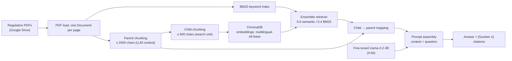

# Indonesian Legal RAG

This is a capstone project for the **Pengembangan Generative AI berbasis LLM** Dicoding class.

Fine-tuning **Llama-3.2-3B** for Indonesian instruction following, then building a **legal-domain RAG chatbot** on top of the fine-tuned model, answering questions about Indonesian regulations with citable answers.

## Project Overview

The project is split into two stages, matching the two notebooks:

| Stage                     | Notebook           | What it does                                                                                                                                                                                                         |
| ------------------------- | ------------------ | -------------------------------------------------------------------------------------------------------------------------------------------------------------------------------------------------------------------- |
| 1. Supervised Fine-Tuning | `finetuning.ipynb` | QLoRA fine-tuning of Llama-3.2-3B on an Indonesian instruction dataset. Two hyperparameter experiments are compared, the best run is selected automatically, and the merged model is pushed to the Hugging Face Hub. |
| 2. Legal RAG Chatbot      | `rag.ipynb`        | A retrieval-augmented chatbot over Indonesian regulation PDFs using the fine-tuned model: hybrid BM25 + semantic retrieval, parent-child chunking, metadata filtering, and cited answers.                            |

## Repository Structure

| File               | Description                                                                                           |
| ------------------ | ----------------------------------------------------------------------------------------------------- |
| `finetuning.ipynb` | QLoRA fine-tuning pipeline, hyperparameter experiments, and push to Hugging Face.                     |
| `rag.ipynb`        | Legal RAG chatbot: ingestion, hybrid retrieval, generation with citations, and interactive chat loop. |
| `requirements.txt` | Snapshot of the full Colab environment used for development.                                          |

## Part 1: Supervised Fine-Tuning (QLoRA)

**Configuration**

| Item                 | Choice                                                                                                                                                           |
| -------------------- | ---------------------------------------------------------------------------------------------------------------------------------------------------------------- |
| Base model           | [`unsloth/Llama-3.2-3B`](https://huggingface.co/unsloth/Llama-3.2-3B) (4-bit, NF4 + double quantization, fp16 compute, sized for a T4 GPU)                       |
| Method               | LoRA adapters via [Unsloth](https://github.com/unslothai/unsloth) `FastLanguageModel`                                                                            |
| Chat template        | Llama-3.2 (via `unsloth.chat_templates`)                                                                                                                         |
| Dataset              | [`Ichsan2895/alpaca-gpt4-indonesian`](https://huggingface.co/datasets/Ichsan2895/alpaca-gpt4-indonesian) : first 6,400 samples, 90/10 train/eval split (seed 42) |
| Training experiments | Two runs (A & B) with identical data and split, tracked in **Weights & Biases**                                                                                  |

**Hyperparameter experiments**

| Experiment | Learning rate | LoRA `r` | LoRA `alpha` | Max steps |
| ---------- | ------------- | -------- | ------------ | --------- |
| A          | 2e-4          | 16       | 32           | 800       |
| B          | 1e-4          | 8        | 16           | 800       |

Train and eval loss curves are plotted for both runs, and the best experiment is selected automatically by **lowest best `eval_loss`** with an overfitting-trend guard. The winning adapter is then merged, smoke-tested with streaming inference, and uploaded.

> **Note on the sparse eval/steps setup:** train loss is logged every step, but evaluation only runs every 400 steps (step 400 and 800 of a max-steps 800 run), saving only a single checkpoint (`save_total_limit=1`). GPU compute is expensive.

## Part 2: Legal RAG Chatbot

The chatbot answers questions about Indonesian employment/company regulations by retrieving relevant passages from a corpus of regulation PDFs and generating answers grounded in them, with explicit source citations.

**Pipeline components**

| Component      | Choice                                                                                                                                                      |
| -------------- | ----------------------------------------------------------------------------------------------------------------------------------------------------------- |
| Data source    | Regulation PDFs downloaded from a Google Drive folder (`gdown`)                                                                                             |
| Text splitting | Parent-child retriever: large **parent** chunks for the LLM context, small **child** chunks as the vector-search unit                                       |
| Metadata       | Each chunk carries `jenis_dokumen`, `nomor_dokumen`, `tahun_dokumen`, `sumber_file`, enabling metadata filtering (doc type / number / year)                 |
| Embeddings     | [`intfloat/multilingual-e5-base`](https://huggingface.co/intfloat/multilingual-e5-base) via `sentence-transformers`                                         |
| Vector store   | Persisted local **ChromaDB**                                                                                                                                |
| Retriever      | **Ensemble retriever**: BM25 (keyword) + ChromaDB (semantic); semantic wins on meaning, BM25 rescues literal legal terms (article numbers, specific jargon) |
| Generation     | The fine-tuned model from Stage 1, loaded in 4-bit                                                                                                          |
| Output         | Concise Indonesian answers with `[Sumber n]` citation headers per retrieved passage                                                                         |
| Interface      | Interactive `input()` loop chat, answers rendered with `IPython.display`                                                                                    |

**Key runtime parameters** (all configurable in the notebook's Global Configuration cell):

| Group      | Values                                                                                                  |
| ---------- | ------------------------------------------------------------------------------------------------------- |
| Chunking   | parent 2000 / overlap 100 · child 600 / overlap 50                                                      |
| Retrieval  | semantic weight 0.6 · keyword weight 0.4 · `SEARCH_K` 10 · `TOP_K_CONTEXT` 5 · max context 12,000 chars |
| Generation | `max_new_tokens` 384 · temperature 0.2 · repetition penalty 1.15                                        |

## Published Model

The best fine-tuned model from Stage 1 is available on the Hugging Face Hub: [m-b-edw/llama-3.2-3b-sft-indonesian](https://huggingface.co/m-b-edw/llama-3.2-3b-sft-indonesian).

The RAG notebook (Stage 2) loads exactly this model.
